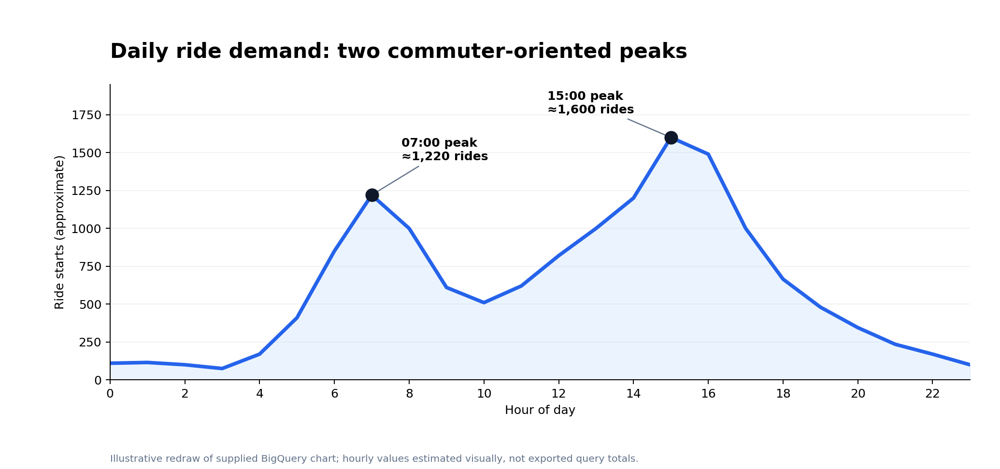
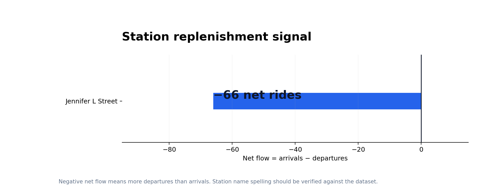

# UrbanRoll | Bike-Share Operations & Customer Analytics

**SQL · Google BigQuery · Operational Analytics · Customer Segmentation**


---

## Executive Summary

Analyzed **15,000 rides, 1,000 users, and 25 stations** in a simulated bike-sharing operation to identify demand patterns, compare customer segments, audit trip quality, and pinpoint station replenishment opportunities.

Used **Google BigQuery and relational SQL** to transform transactional records into operational insights and business recommendations.

### Project at a Glance

| Metric | Result |
|---|---:|
| Rides Analyzed | **15,000** |
| User Records | **1,000** |
| Stations | **25** |
| Daily Demand Peaks | **7:00 AM & 3:00 PM** |
| Jennifer L Street Net Flow | **−66 rides** |
| Trips Under 2 Minutes | **106** |
| Zero-Distance Trips | **1** |

### Key Analytical Outcomes

- Identified two major daily demand peaks to inform operational planning.
- Analyzed subscriber and casual rider behaviour to support customer segmentation.
- Identified a station with **66 more departures than arrivals**, highlighting a potential replenishment priority.
- Flagged unusual ride records using SQL-based data-quality checks.
- Developed recommendations for fleet positioning, customer engagement, and operational monitoring.

---

## 1. Business Problem & Objectives

Bike-sharing operators must balance fluctuating customer demand, station availability, and operational resources.

Three business challenges informed this analysis:

**Demand Fluctuation:** Customer usage varies significantly throughout the day, affecting staffing and fleet availability.

**Customer Segmentation:** Subscribers and casual riders exhibit different travel patterns and service needs.

**Fleet Imbalance:** Unequal station arrivals and departures can create vehicle shortages and surpluses.

### Key Business Questions

1. When should the operator anticipate peak ride demand?
2. How do subscribers and casual riders differ in their usage patterns?
3. Which stations experience net bike outflows?
4. Which ride records require closer data-quality review?
5. How can the analytical findings support operational decisions?

---

## 2. Dataset & Technical Environment

The analysis uses three relational datasets.

| Table | Records | Description |
|---|---:|---|
| `rides` | 15,000 | Ride transactions |
| `users` | 1,000 | Customer profiles and membership information |
| `stations` | 25 | Station locations and capacities |

### Data Relationships

The tables are connected through the following keys:

- `rides.user_id` → `users.user_id`
- `rides.start_station_id` → `stations.station_id`
- `rides.end_station_id` → `stations.station_id`

### Technical Stack

**Platform:** Google BigQuery

**Language:** GoogleSQL

**Techniques:**

- Common Table Expressions (CTEs)
- Relational Joins
- Conditional Aggregation
- CASE Statements
- Date and Time Functions
- Data Validation
- KPI Calculations
- Exploratory Data Analysis

---

# 3. Executive Insights & Business Recommendations

## Insight 1: Daily Demand Exhibits a Double-Peak Pattern

### Business Question

When does ride demand peak, and how can the operator optimize fleet availability?

### Analysis

Aggregated ride transactions by starting hour using SQL date/time functions to evaluate demand fluctuations throughout the day.

### Results

The analysis identified two primary demand peaks:

- **7:00 AM:** Morning demand peak
- **3:00 PM:** Strongest afternoon demand peak
- **10:00 AM:** Demand moderates after the morning rush
- **3:00–5:00 PM:** Elevated afternoon activity

### Hourly Demand Visualization



*Figure: Hourly ride-demand pattern recreated from BigQuery results. Counts are approximate.*

The observed pattern is consistent with commuter-related travel, with demand concentrated during morning and afternoon periods.

### Business Recommendations

**Pre-Peak Fleet Rebalancing**

Evaluate repositioning vehicles between **10:00 AM and 2:00 PM**, before the afternoon demand surge.

**Operational Scheduling**

Align maintenance, staffing, and vehicle distribution with observed demand patterns.

**Demand Monitoring**

Use hourly ride counts as an operational KPI to inform recurring fleet-planning decisions.

### Business Value

Supports demand-aligned scheduling, more efficient resource allocation, and improved readiness during peak usage periods.

---

## Insight 2: Subscriber and Casual Riders Display Distinct Behaviours

### Business Question

How do customer membership segments differ in usage patterns?

### Analysis

Joined the `rides` and `users` datasets to analyze:

- Ride frequency
- Average journey duration
- Average travel distance
- Membership characteristics

### Results

Two distinct customer profiles emerged.

| Customer Segment | Observed Characteristics |
|---|---|
| Subscribers | Shorter, predictable journeys; approximately 15-minute average |
| Casual Riders | Longer average journeys and greater travel distances |

### Customer Personas

#### The Commuter — Subscriber

Typically takes shorter, recurring journeys and may place greater importance on availability and convenience.

**Potential priorities:**
- Reliable bike availability
- Convenient station access
- Consistent service during commuting periods

#### The Explorer — Casual Rider

Typically takes longer trips, potentially associated with leisure or occasional transportation.

**Potential opportunities:**
- Weekend promotional passes
- Off-peak riding incentives
- Membership conversion campaigns

### Business Recommendations

- Differentiate customer strategies based on membership behaviour.
- Prioritize reliable availability for commuter-oriented journeys.
- Test targeted promotions designed to encourage casual riders to use the service more frequently.

### Business Value

Demonstrates how customer-level behavioural analysis can inform segmentation, service planning, and targeted marketing decisions.

---

## Insight 3: Station Net Flow Reveals Fleet Rebalancing Opportunities

### Business Question

Which stations experience net vehicle outflows that may create replenishment requirements?

### Analysis

Developed a station-level net-flow calculation using SQL Common Table Expressions.

The analytical process involved:

1. Aggregating departures by starting station.
2. Aggregating arrivals by destination station.
3. Joining the results with station information.
4. Calculating the net movement of bikes.

### Operational KPI

**Net Flow = Total Arrivals − Total Departures**

| Net Flow | Interpretation |
|---|---|
| Positive | More bikes arrive than depart |
| Negative | More bikes depart than arrive |
| Zero | Equal arrivals and departures |

### Key Finding: Jennifer L Street

The analysis identified **Jennifer L Street** as a leading departure station.

Its recorded net flow was:

### −66 Rides

This indicates **66 more departures than arrivals** during the analyzed period.

The finding highlights a potential replenishment requirement at a station experiencing high departure activity.

### Station Net-Flow Visualization



*Figure: Net outflow at Jennifer L Street.*

### Business Recommendations

**1. Targeted Replenishment**

Include stations experiencing sustained negative net flows in fleet replenishment planning.

**2. Station-Level Monitoring**

Track arrivals, departures, and net flow as recurring operational indicators.

**3. Dynamic Incentives**

Evaluate return incentives that encourage riders to end journeys at stations experiencing shortages.

**4. Fleet Distribution**

Use station movement patterns to support more informed allocation of operational resources.

### Business Value

Converts transactional ride data into a practical operational metric that can inform vehicle availability, fleet planning, and customer service decisions.

---

## Insight 4: Data Quality Assessment Identifies Unusual Ride Records

### Business Question

Are transactional records sufficiently complete and consistent for operational analysis?

### Analysis

Performed SQL-based checks for:

- Missing ride identifiers
- Missing user identifiers
- Missing start and end timestamps
- Unusually short ride durations
- Zero-distance journeys

### Results

Initial completeness checks found no null values in the inspected key identifiers and timestamp fields.

| Data Quality Indicator | Finding |
|---|---:|
| Rides Under 2 Minutes | **106** |
| Zero-Distance Rides | **1** |
| Short-Duration Rides as % of Total | **0.71%** |

The 106 short-duration observations represent approximately 0.71% of all 15,000 rides.

### Business Recommendation

Incorporate exception monitoring into regular reporting workflows and review unusual transactions before using them in downstream performance analysis.

### Business Value

Demonstrates the importance of reliable transactional data in producing credible analytical findings and operational KPIs.

---

# 4. SQL Implementation

The project applies SQL to analyze transactional activity, customer behaviour, and operational performance.

## 4.1 Hourly Demand Analysis

```sql
SELECT
    EXTRACT(HOUR FROM start_time) AS ride_hour,
    COUNT(*) AS total_rides

FROM `sql-practice-end-to-end.sql_practice.rides`

GROUP BY ride_hour
ORDER BY ride_hour;
```

**Purpose:** Identify demand fluctuations and peak usage periods.

---

## 4.2 Customer Segmentation

```sql
SELECT
    u.membership_level,

    COUNT(r.ride_id) AS total_rides,

    ROUND(
        AVG(r.distance_km), 2
    ) AS avg_distance_km,

    ROUND(
        AVG(
            TIMESTAMP_DIFF(
                r.end_time,
                r.start_time,
                SECOND
            ) / 60.0
        ), 2
    ) AS avg_duration_minutes

FROM `sql-practice-end-to-end.sql_practice.rides` r

INNER JOIN
    `sql-practice-end-to-end.sql_practice.users` u
    ON r.user_id = u.user_id

GROUP BY u.membership_level
ORDER BY total_rides DESC;
```

**Purpose:** Compare membership-level ride volume, duration, and distance.

---

## 4.3 Station Popularity Analysis

```sql
SELECT
    s.station_name,
    COUNT(r.ride_id) AS total_departures

FROM `sql-practice-end-to-end.sql_practice.rides` r

INNER JOIN
    `sql-practice-end-to-end.sql_practice.stations` s
    ON r.start_station_id = s.station_id

GROUP BY s.station_name

ORDER BY total_departures DESC

LIMIT 10;
```

**Purpose:** Identify high-volume departure stations.

---

## 4.4 Station Net-Flow Analysis

```sql
WITH departures AS (

    SELECT
        start_station_id AS station_id,
        COUNT(*) AS total_departures

    FROM `sql-practice-end-to-end.sql_practice.rides`

    GROUP BY start_station_id
),

arrivals AS (

    SELECT
        end_station_id AS station_id,
        COUNT(*) AS total_arrivals

    FROM `sql-practice-end-to-end.sql_practice.rides`

    GROUP BY end_station_id
)

SELECT
    s.station_name,

    COALESCE(
        d.total_departures, 0
    ) AS total_departures,

    COALESCE(
        a.total_arrivals, 0
    ) AS total_arrivals,

    COALESCE(a.total_arrivals, 0)
    - COALESCE(d.total_departures, 0)
    AS net_flow

FROM `sql-practice-end-to-end.sql_practice.stations` s

LEFT JOIN departures d
    ON s.station_id = d.station_id

LEFT JOIN arrivals a
    ON s.station_id = a.station_id

ORDER BY net_flow ASC;
```

**Purpose:** Identify stations experiencing net bike outflows and inflows.

---

## 4.5 Data Quality Assessment

```sql
SELECT
    COUNT(*) AS total_rides,

    COUNTIF(
        TIMESTAMP_DIFF(
            end_time,
            start_time,
            SECOND
        ) < 120
    ) AS short_duration_rides,

    COUNTIF(
        distance_km = 0
    ) AS zero_distance_rides

FROM `sql-practice-end-to-end.sql_practice.rides`;
```

**Purpose:** Identify potentially unusual trip records for further review.

---

# 5. Executive Recommendations

| Business Priority | Analytical Evidence | Recommended Action |
|---|---|---|
| Demand Readiness | Peaks at 7 AM and 3 PM | Evaluate pre-peak fleet repositioning |
| Customer Segmentation | Different subscriber and casual usage patterns | Test segment-specific offerings |
| Fleet Availability | −66 net flow at Jennifer L Street | Prioritize replenishment assessment |
| Reporting Reliability | 106 short rides and 1 zero-distance ride | Integrate data-quality monitoring |

### Strategic Takeaways

**Operational Efficiency**

Historical usage patterns can inform scheduling and resource allocation.

**Customer Intelligence**

Membership-level behavioural differences provide a basis for more targeted service strategies.

**Fleet Optimization**

Station net-flow analysis helps identify potential availability imbalances.

**Data Reliability**

SQL-based data validation supports more dependable performance reporting.

---

# 6. Repository Structure

```text
urbanroll-bike-share-analytics/
│
├── README.md
│
├── sql/
│   ├── 01_data_quality.sql
│   ├── 02_hourly_demand.sql
│   ├── 03_membership_segments.sql
│   ├── 04_ride_duration.sql
│   ├── 05_popular_stations.sql
│   └── 06_station_net_flow.sql
│
└── figures/
    ├── hourly_demand_redesigned.png
    └── station_net_flow_redesigned.png
```

---

# 7. Skills Demonstrated

| Technical / Business Competency | Application |
|---|---|
| SQL | Transactional data querying |
| Google BigQuery | Cloud-based analytics |
| Data Validation | Completeness and exception checks |
| Relational Joins | Combining customer, ride, and station records |
| CTEs | Multi-step operational analysis |
| Aggregations | Calculating key business metrics |
| Temporal Analysis | Evaluating hourly demand |
| Customer Segmentation | Comparing rider characteristics |
| Operational Analytics | Analyzing station movements |
| KPI Development | Calculating ride volumes and net flow |
| Business Intelligence | Translating data into operational insights |
| Decision Support | Developing evidence-based recommendations |

---

# 8. Project Summary

This project demonstrates how SQL can be applied to operational business challenges beyond basic data extraction.

By analyzing **15,000 rides, 1,000 users, and 25 stations**, I evaluated customer behaviours, identified key demand periods, assessed transactional data quality, and calculated station-level fleet imbalances.

The findings informed recommendations for resource allocation, demand-aligned scheduling, customer segmentation, and station replenishment.

The project highlights my ability to connect technical analysis with practical business decision-making.

---

## About the Analyst

**Anuradha Biswas**

Master of Business Economics  
Wilfrid Laurier University

**Areas of Interest:** Business Analytics, Data Analytics, Financial Analysis, Economic Research

**Technical Toolkit:** SQL · Google BigQuery · Power BI · Excel · Stata · R

---

*Guided SQL analytics practice project using a simulated bike-sharing dataset, with results organized into a business-focused portfolio case study.*
